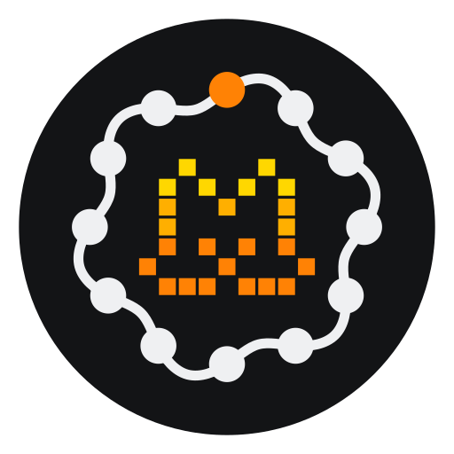

# cadencr-plugin-provider-vibe

Cadencr code-backed provider connector for the [Mistral Vibe](https://github.com/mistralai/mistral-vibe) coding agent.

<p align="center">
  
</p>

The connector implements the Cadencr provider executable contract:

| Command | Behavior |
| --- | --- |
| `version` | Prints the connector version. |
| `models --format acp-config-options-v1 --cwd <abs>` | Opens a disposable ACP session against `vibe-acp`, reads the live model selector from `session/new`, closes the session, and prints the ACP v1 `SessionConfigOption` array. |
| `run --protocol acp-v1` | Execs the native `vibe-acp` binary with stdin/stdout/stderr unchanged. Vibe speaks ACP v1 natively, so there is no translation layer. |

## Prerequisites

Install Git, Rust/Cargo, and Python 3.

## Install the Vibe CLI

```bash
curl -LsSf https://mistral.ai/vibe/install.sh | bash
# or: uv tool install mistral-vibe
```

This installs `vibe`, `vibe-acp`, and `vibe-app-server`. The connector execs
`vibe-acp`.

Authentication is handled entirely by the native Vibe CLI, per the Cadencr
connector contract. Configure it before importing or running the connector:

```bash
# either sign in / store credentials in ~/.vibe/.env
vibe --setup

# or export your key in the environment
export MISTRAL_API_KEY=...
```

The connector and Cadencr never collect, store, or broker Vibe credentials.

## Build

Clone this repository into the folder you want CadencR to use as the connector
project, then build its stable entrypoint:

```bash
git clone https://github.com/edjubert/cadencr-plugin-provider-vibe.git
cd cadencr-plugin-provider-vibe
python3 scripts/build-provider.py
./bin/provider version
```

The build script compiles the native release binary and installs it as an
executable at `bin/provider` (`bin/provider.exe` on Windows). Build outputs
under `target/` and `bin/` are ignored by Git.

For a model-discovery check before importing:

```bash
./bin/provider models --format acp-config-options-v1 --cwd "$PWD"
```

On Windows, use these PowerShell equivalents:

```powershell
python scripts/build-provider.py
.\bin\provider.exe version
.\bin\provider.exe models --format acp-config-options-v1 --cwd (Get-Location).Path
```

## Binary resolution

`vibe-acp` is resolved in this order:

1. `CADENCR_VIBE_ACP_PATH` environment variable (absolute path recommended);
2. `vibe-acp` on `PATH`.

## Install through CadencR settings

1. Install and authenticate the native Vibe CLI, then build the connector with
   the commands above. CadencR requires the executable to exist before import.
2. Open **Settings → Providers → Add provider**.
3. Select **From existing folder** and fill in:

   | Field | Value |
   | --- | --- |
   | Display name | `Mistral Vibe` |
   | Provider ID | `mistral-vibe` |
   | Connector folder | The absolute path to this repository's root, containing `.git`, `bin/provider`, and `icon.svg`. |

4. Click **Import provider project**.
5. Restart CadencR, then select **Mistral Vibe** and one of its discovered models.

CadencR creates the provider project, conversation, and local descriptor. It
uses this repository in place, with the stable `bin/provider` executable and
the root Mistral `icon.svg`. There is no descriptor file to copy or edit when
using this flow. The executable must already be built: CadencR does not build
the connector during import.

The folder must be the root of an existing Git repository. A folder already
registered as an ordinary CadencR project cannot be reclassified through this
dialog; clone the connector to a separate folder and build that checkout
before importing it. The provider ID must also be available in CadencR.
An existing manual descriptor using `mistral-vibe` must be unregistered before
importing that same ID through settings.

After updating the source, quit CadencR, run `python3 scripts/build-provider.py`
again in the imported checkout, and restart CadencR. Provider registration is
fixed for the service process lifetime; hot reload is not supported.

This is CadencR's local developer import workflow, not marketplace installation.

### Advanced: manual descriptor installation

The settings flow above is recommended. If managing descriptors manually:

1. Build `bin/provider` using the build script.
2. Copy `descriptor/mistral-vibe.json` to
   `~/.cadencr/settings/providers/mistral-vibe.json`.
3. Replace both `/ABSOLUTE/PATH/TO/...` placeholders with this repository's
   absolute path. On Windows, point `installation.executable.command` at
   `bin/provider.exe`.
4. Restart CadencR.

Keep `installation.assets.directory` at the repository root, which contains
the Mistral `icon.svg`. If the native CLI is not discoverable through `PATH`,
add `CADENCR_VIBE_ACP_PATH` with its absolute path to
`installation.executable.env`; provider-account authentication remains in
the native Vibe CLI.

For a CadencR development checkout, settings default to `cadencr-settings`
beside the database file. With the standard `pnpm dev` configuration
(`CADENCR_DB_PATH=./cadencr.local.db`), the manual descriptor belongs in
`packages/service/cadencr-settings/providers/mistral-vibe.json`.
`CADENCR_SETTINGS_DIR` overrides this location. Restart `pnpm dev` after
installing it. The settings import flow handles this location automatically.

## Notes

- Model discovery uses a real disposable ACP session so the pre-session
  selector always matches the live session selector (same binary, same ids).
  Discovery stays under Cadencr's 10-second host timeout with an internal
  8-second budget.
- Vibe releases are frequent (several per week). The connector only relies on
  stable ACP v1 surface (`initialize`, `session/new`, `session/close`,
  `configOptions`), so a CLI upgrade does not require a connector change.
- The `thinking` config option Vibe exposes uses a non-standard category
  (`thinking` instead of `thought_level`). It appears in Cadencr as a generic
  selector, not as the native thinking-effort control.
- Durable resume: Vibe advertises `loadSession` (legacy load with replay
  suppression on the Cadencr side) and `session/close`. Cadencr handles both
  automatically.
- Publication to the Cadencr registry (signed package via `pack-provider`)
  is a later step; the registry contribution gate is not open yet.

## Logo assets

The [logos directory](logos/README.md) holds the connector logo used on
GitHub: the SVG logo, transparent PNG exports from 16 to 1024 px, and a
visual comparison with the Cadencr mark. The root `icon.svg` stays the
Mistral mark referenced by the provider descriptor, so CadencR keeps
displaying the Mistral logo.

To regenerate the PNG exports:

```bash
python3 scripts/export-logos.py
```

## License

The connector is licensed under [Apache-2.0](LICENSE).
The CadencR icon is the Mistral mark from Lobe Icons (MIT). The GitHub
connector logo combines the Cadencr dot ring with the Mistral Vibe pixel cat
head, adapted from Miaou. See [third-party notices](THIRD_PARTY_NOTICES.md)
for sources, licenses, and trademark notes.
